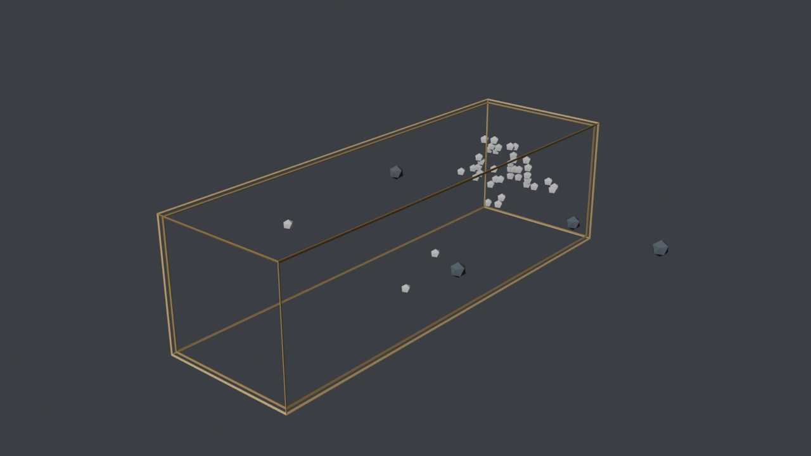

# X-Plane SND for Blender

Import, edit and write back X-Plane `.snd` sound files in 3D — every sound attachment becomes a
Speaker in the viewport, and the listening zones (`AABB` / `SPHERE`) become editable wire volumes.

<table>
<tr>
<td></td>
<td></td>
</tr>
<tr>
<td>Video: finding and fixing the C90 sound-space bug (3 min)</td>
<td>413 sound positions against the cockpit listening zone</td>
</tr>
</table>

Found the invisible box that decides when X-Plane switches from interior to exterior audio, drag
it into place, export. Untouched files come back byte for byte — it edits your `.snd`, it does not
rewrite it.

## Install

1. Download `io_scene_xplane_snd-<version>.zip` from [Releases](https://github.com/cpuwolf/io_scene_xplane_snd/releases).
2. Blender ▸ `Edit ▸ Preferences ▸ Get Extensions ▸ ⌄ ▸ Install from Disk…` and pick the zip
   (or `Get Extensions ▸ X-Plane SND` once it is listed on extensions.blender.org).
3. Restart Blender — an already-running instance keeps the old module in memory.

Requires **Blender 5.2 LTS**. No other add-on is needed: it does not require XPlane2Blender or
`io_scene_xplane_obj`, and it never calls them.

## Quick start

1. Drag `…/Aircraft/<your aircraft>/fmod/*.snd` into the 3D viewport (or `File ▸ Import ▸ X-Plane SND`).
2. Open the sidebar (`N`) ▸ `X-Plane` ▸ `X-Plane SND`. Every attachment is a Speaker, muted by
   default; the listening zones appear as wire boxes.
3. Move the Speakers and zones where they belong. `Solo selected` plays one cue at a time.
4. `File ▸ Export ▸ X-Plane SND (.snd)` writes back to the imported path.

> **Export overwrites that file.** Keep a backup, or export to a copy and rename it to the
> original file name before launching X-Plane.

## What it does

- **Sound positions as Speakers** — position, orientation cone, per-object metadata; drag to move,
  `Shift+D` to add another position for the same event.
- **Listening zones as wire volumes** — boundary plus an inner shell at `BLEND_DEPTH`, so the
  interior/exterior fade is something you can see; move, resize, create new zones and extra volumes.
- **Byte-exact round trip** — only edited lines are rewritten; verified on all 56 `.snd` files of a
  full X-Plane 12 install, including payware, ground vehicles, jetways and carriers.
- **Correct coordinates** — resolves `REF_POINT_ACF`, or the aircraft's default CG from the `.acf`
  (feet → metres), and offers the axis mapping the OBJ8 importers use so sounds land on your
  cockpit geometry.
- **Events stay grouped** — one collection per `EVENT_NAME`, with select / isolate / rename-whole-group;
  per-position trigger conditions are preserved.

## Questions people ask first

| Question | Answer |
|---|---|
| Does it modify my aircraft permanently? | Only the `.snd` you export, line by line. Untouched files export byte-identically. |
| Do I need XPlane2Blender? | No. Zero dependencies, pure Blender API. |
| Which Blender? | 5.2 LTS (built and tested on 5.2.2 / 5.2.4). |
| Will my sound play in Blender? | Attach an audio file to a Speaker and use `Solo selected`; Speaker has no start/end frame, so others stay muted. |
| Can it create sound spaces? | Yes — place the 3D cursor, hit `+` in the sidebar; new zones are written as proper `BEGIN_SOUND_SPACE` blocks. |
| Why do positions look offset from my model? | Axis mode: switch to *align with imported mesh*, or check the resolved origin shown in the panel. |
| Can I edit trigger conditions? | Not yet. Conditions are preserved, copied to duplicates, and shown in custom properties. |

## Documentation

| Doc | Contents |
|---|---|
| [Using the add-on](https://github.com/cpuwolf/io_scene_xplane_snd/blob/main/doc/usage.md) | import options, coordinates, axis modes, export, panel, events |
| [Sound spaces](https://github.com/cpuwolf/io_scene_xplane_snd/blob/main/doc/sound-space.md) | format limits, how zones are drawn, editing and creating them |
| [Design notes](https://github.com/cpuwolf/io_scene_xplane_snd/blob/main/doc/design.md) | why Speakers, why metadata on objects, why line patches |
| [Development](https://github.com/cpuwolf/io_scene_xplane_snd/blob/main/doc/development.md) | headless tests, build, CI, release rules |
| [Store listing](https://github.com/cpuwolf/io_scene_xplane_snd/blob/main/doc/extensions-listing.md) | text and assets used for the extensions.blender.org submission |

## Limitations

Reads and writes `.snd` only — no FMOD banks, no audio encoding, no dataref condition editor.
Deleting a zone or volume still means editing the text.

## License

GPL-3.0-or-later. Not affiliated with Laminar Research; X-Plane is a trademark of Laminar Research.
