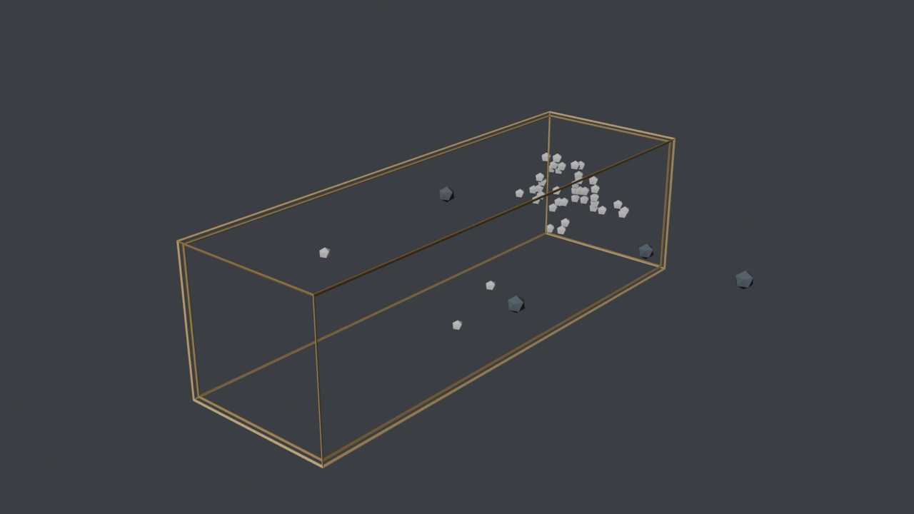
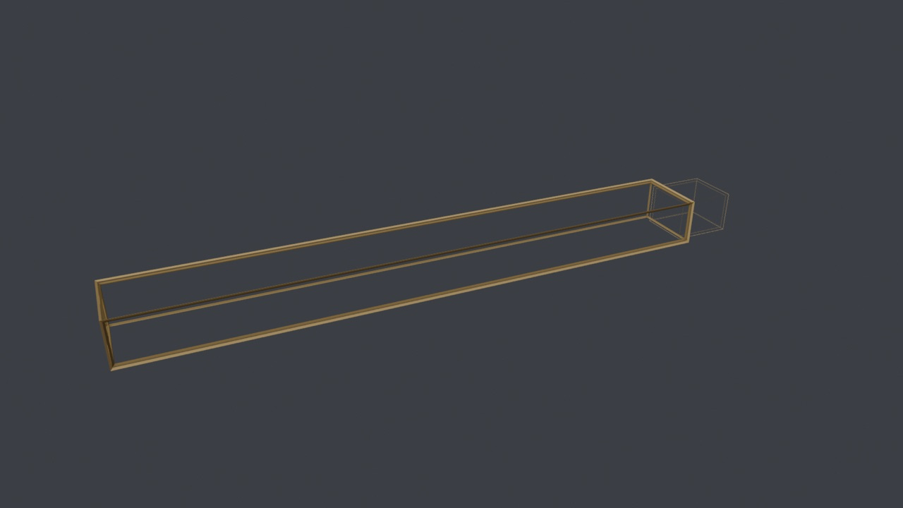

# Sound spaces (listening zones)

A `BEGIN_SOUND_SPACE` block decides `sim/operation/sound/inside_ratio[n]`: 1 inside the
volume (interior mix), 0 outside (exterior mix), with a linear transition from the boundary
inwards over `BLEND_DEPTH` metres. This add-on draws them, edits them and creates them.

See also: [`usage.md`](usage.md) for the import/export basics.

## What the format allows

From the official `.snd` specification (Sound Space Definitions):

- up to **64** sound spaces; `SOUND_INDEX 0–63`, one index per `inside_ratio[n]` dataref;
- a space is the **union of one or more volume primitives** — `AABB` (six numbers) and
  `SPHERE` (centre + radius) can be mixed, and the volumes may be **disjoint or overlapping**;
- `BLEND_DEPTH` is measured from the boundary of that union inwards (ratio 0 at the edge,
  1.0 at `BLEND_DEPTH` inside);
- coordinates are metres in aircraft axes (`+X` right, `+Y` up, `+Z` aft), relative to the
  default CG — or to `REF_POINT_ACF` when the file declares it;
- a space cannot be nested inside an attachment and must be closed before the next one starts.

Measured across the 22 official `.snd` files of X-Plane 12: **4 files have two spaces**
(A330, A330_AI, b738, MD80 — indexes 0 and 1), and **no official file puts more than one
volume in a space** (allowed by the format, simply unused by Laminar). Both cases are covered
by `tests/spaces.py`.

## How it is drawn

Two nested wire volumes per primitive:

| Layer | Meaning | Colour |
|---|---|---|
| boundary | the `AABB` / sphere surface — the mathematical edge | amber (AABB) / cyan (SPHERE) |
| core | boundary inset by `BLEND_DEPTH` — full-volume region | same hue, darkened |

The band between them is the blend region. Implementation choices, and why:

- **solid faces + a `Wireframe` modifier**, not `display_type='WIRE'`: a wire-display object
  is drawn with the theme wire colour (grey) in Solid mode and disappears inside cockpit
  geometry; the modifier turns edges into real geometry so the material colour shows.
- `show_in_front = True`, so the boxes are visible through the fuselage.
- tube thickness = 0.5 % of the volume size (clamped 0.008–0.2 m): a 3 m cockpit and a 29 m
  cabin get the same visual weight.
- mesh vertices are relative to the box centre and the object sits on that centre — otherwise
  scaling with `S` would move the box towards the aircraft origin.

Zone objects carry `snd_space_index`, `snd_space_kind`, `snd_space_role`, `snd_volume_index`,
`snd_blend_depth`, `snd_sound_index`, `snd_owner_name` — and **no `snd_uid`**, so the
attachment exporter never mistakes them for sound positions.

## Editing rules

| You change | Written back as |
|---|---|
| move / rotate / scale the **boundary** box | that volume's six `AABB` numbers — the axis-aligned bounds **after** the transform |
| move / scale a **sphere** | `SPHERE` centre and radius (radius = half the longest side of the world bounds) |
| set the object's `snd_blend_depth` property | the `BLEND_DEPTH` line (inserted after `SOUND_INDEX` if absent) |
| move the `_core` inner box | nothing — it is derived from `BLEND_DEPTH` |

Deliberate boundaries:

- **Only the original object counts** (`snd_owner_name` must equal the object name). A
  `Shift+D` copy is skipped with a warning: new volumes are created explicitly, so silently
  absorbing a duplicate would be worse than refusing it.
- Differences **below 0.5 mm** are "not edited", which is what keeps unedited files
  byte-identical on export.
- Rotating or non-uniformly scaling a box writes the **axis-aligned outer bounds** — the
  format only stores AABBs, so this is the only correct answer, not an approximation. A
  non-uniformly scaled sphere produces a warning because it is no longer a sphere.
- Write-back is a line patch: moving one box changes exactly one line, tab indentation and the
  other 2992 lines of a C90B file stay untouched.

## Creating zones and volumes

1. Put the 3D cursor where the zone should start (`Shift + right click`).
2. Sidebar panel: `+` next to the *Sound spaces* header creates a new zone; `+` at the end of
   a zone row adds a volume **to that zone** (union).
3. `F9` adjusts shape (box / sphere), size or radius, `SOUND_INDEX` (`-1` = next free index),
   `BLEND_DEPTH`.
4. On export a new zone is appended as a full `BEGIN_SOUND_SPACE … END_SOUND_SPACE` block,
   placed after the last existing zone and before the attachments (Laminar's own layout); a
   new volume is inserted just before the target zone's `END_SOUND_SPACE`.

Measured on the C90B (2993 lines): adding one zone produces 2999 lines, a `difflib` run shows
**a single insert operation and no deletions or replacements**, and the 436 attachments still
parse identically. The scene's source baseline is refreshed after a successful export, so
exporting the same scene twice does not append the block twice.

`SOUND_INDEX` is clamped to 0–63 and a collision with an existing index raises a warning
(the same index means the same `inside_ratio`).
